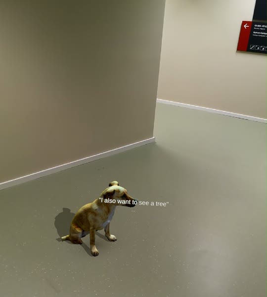
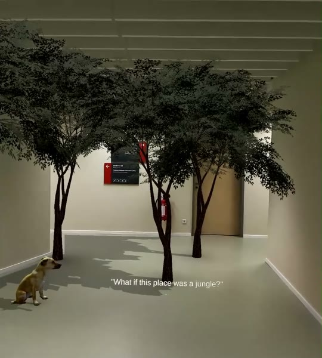
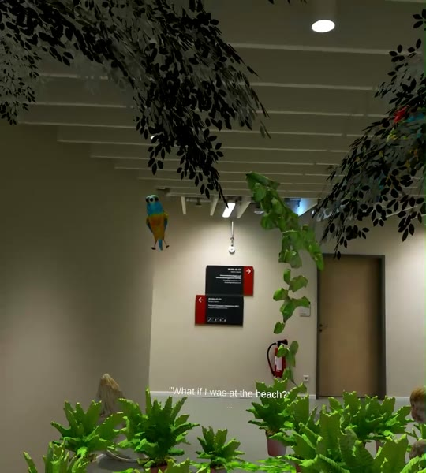
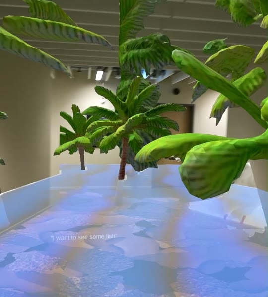
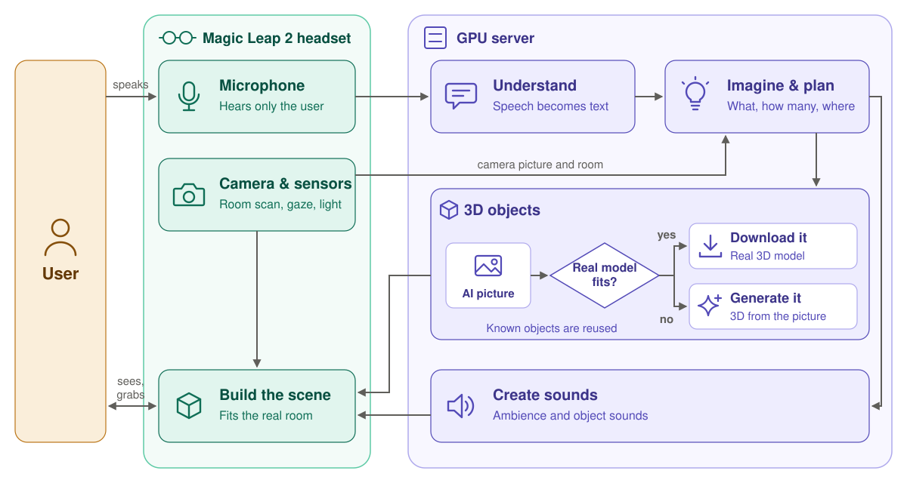
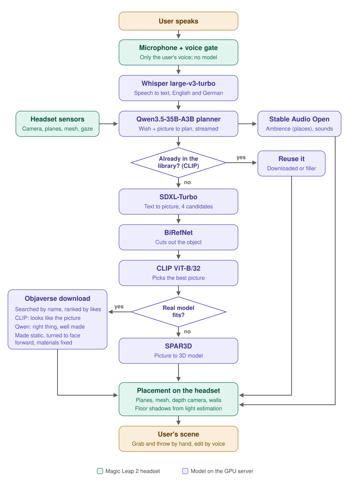

# What If?

**Say a wish and see it appear in the room around you, on the Magic Leap 2.**

What If is an augmented reality app for the Magic Leap 2. You speak a wish. A GPU server plans the
scene and then downloads a real 3D model or generates one. The headset places each object in your
real room: on the floor, on tables, under them or around you. Nothing is pre-built. Every object,
patch of moss, sand or water, and sound is picked or made for the wish while you wait.

<table>
  <tr>
    <td></td>
    <td></td>
    <td></td>
    <td></td>
  </tr>
  <tr>
    <td align="center"><sub>"What if there was a dog sitting in front of me?"</sub></td>
    <td align="center"><sub>"I also want to see a tree."</sub></td>
    <td align="center"><sub>"What if this place was a jungle?"</sub></td>
    <td align="center"><sub>"What if I was at the beach?"</sub></td>
  </tr>
</table>

<sub>All pictures were recorded on the headset in a university corridor.</sub>

## Features

- **Speak naturally.** Whisper transcribes the wish. A voice gate listens only to the wearer, not to
  the people around them. Whether a sentence starts a new scene or changes the current one is decided
  from what it says, with no keywords: *"make it bigger"*, *"put the cat under the table"*,
  *"let the birds fly around"*, *"delete the whole scene"*, *"undo"*. English and German work.
- **Real models first, generated ones when needed.** The server searches Objaverse by name and
  ranks the results by Sketchfab likes. A vision model then checks that it is the right thing and
  well made. If nothing fits, it generates a picture with SDXL-Turbo and turns it into 3D with SPAR3D.
- **Fits into the room.** Objects are placed using the headset's planes, room mesh and depth: on the
  floor, on a table, under it, beside or around things. You can also point at a spot in the camera
  picture, as in *"a crown on that statue"*. Real walls hide virtual objects behind them.
- **Places, not only objects.** The ground gets moss, sand or water as soft-edged patches. Wild
  plants grow without pots. Fish swim under water and dolphins swim at the surface. Ambient sound is
  generated with Stable Audio Open, but only for places.
- **Alive.** Animals and vehicles walk, fly, swim or follow you. They keep a distance from your head
  and face the way they move.
- **Grounded.** Shadows fall on the real floor in the direction of the room's light, using Magic Leap
  light estimation. Segmented dimming makes virtual content look solid.
- **Hands.** Grab an object directly, then move, rotate or scale it. Let go and it drops with
  physics, or throw it.
- **Private if you want.** The planner can be a local Qwen3.5 vision model served by vLLM, so camera
  pictures and speech stay on your network.

## How it works



The headset sends the spoken wish and a camera picture to the server. The planner answers with a
scene plan that is streamed item by item, so the first objects start while the plan is still being
written. For each object the server either reuses a model from its library, downloads a fitting real
model, or generates one. The headset places objects as soon as they arrive.

<details>
<summary><b>The models in detail</b></summary>



| Step | Model | Role |
|---|---|---|
| Speech | faster-whisper large-v3-turbo | Speech to text (English, German) |
| Plan & edits | Qwen3.5-35B-A3B (GPTQ 4-bit, vLLM) or Claude | Wish + camera picture → scene plan / edit operations; checks downloads |
| Picture | SDXL-Turbo | Text → picture of the object (4 candidates) |
| Cut-out | BiRefNet | Removes the background |
| Ranking | CLIP ViT-B/32 | Picks the best picture, searches the library and Objaverse, compares models with the picture |
| Real models | Objaverse (Sketchfab, CC0 / CC-BY) | Downloaded, made static, turned to face forward, materials fixed |
| 3D | SPAR3D | Picture → textured 3D model |
| Sound | Stable Audio Open | Ambience and object sounds |

More: [docs/ARCHITECTURE.md](docs/ARCHITECTURE.md) (design, Magic Leap 2 specifics).
</details>

## Repository

```
unity/WhatIf/   Unity 2022.3 project for the Magic Leap 2 (URP, OpenXR, AR Foundation)
server/         Python server (FastAPI): speech, planner, pictures, 3D, downloads, sounds, cache
docs/           Architecture, diagrams, roadmap
```

## Getting started

You need:

- a **Magic Leap 2**;
- a **GPU server** with Linux or Windows and about 24 GB VRAM for the image, 3D and sound models;
  the local planner needs a second GPU or about 20 GB more;
- **Unity 2022.3 LTS** with Android build support.

### 1. Server

```bash
cd server
python -m venv .venv
.venv/bin/pip install -r requirements.txt     # Windows: .venv\Scripts\pip
cp .env.example .env
```

**Try it without a GPU.** Set `WHATIF_PLANNER=mock` and `WHATIF_IMAGE_PROVIDER=mock` in `.env`, then
run the tests and start the server:

```bash
.venv/bin/python -m pytest -q
.venv/bin/uvicorn whatif.main:app --host 0.0.0.0 --port 8000
```

Open `http://<server-ip>:8000/docs` for the interactive API and `/health` to see which models have
loaded. Allow port 8000 through the firewall so the headset can reach the server.

**Full setup on a GPU.** Each step below is optional and switched on in `.env`:

<details>
<summary><b>Planner: local Qwen3.5 with vLLM, or Claude</b></summary>

- **Claude:** `WHATIF_PLANNER=claude` and an `ANTHROPIC_API_KEY`.
- **Local planner** (camera pictures and prompts stay on your network): Qwen3.5-35B-A3B (4-bit,
  vision, about 20 GB), served by vLLM. vLLM gets its own venv because it pins its own PyTorch:
  ```bash
  python3 -m venv ~/vllm-venv && ~/vllm-venv/bin/pip install --upgrade pip && ~/vllm-venv/bin/pip install "vllm>=0.17"
  ```
  Start it in its own tmux session (`tmux new -s planner`). The first start downloads the model:
  ```bash
  CUDA_VISIBLE_DEVICES=1 ~/vllm-venv/bin/vllm serve Qwen/Qwen3.5-35B-A3B-GPTQ-Int4 --host 127.0.0.1 --port 8001 --max-model-len 16384 --gpu-memory-utilization 0.55 --limit-mm-per-prompt '{"image": 1, "video": 0}' --default-chat-template-kwargs '{"enable_thinking": false}' --reasoning-parser qwen3
  ```
  Then set `WHATIF_PLANNER=local` in `.env`. If vLLM runs on another port, also set
  `WHATIF_LOCAL_URL=http://127.0.0.1:<port>/v1`.
  - **Faster answers:** add `--speculative-config '{"method": "mtp", "num_speculative_tokens": 1}'`
    to use the model's own multi-token prediction. The results stay the same. The server log line
    "local planner: ... answer tokens in ... s" shows the effect. If vLLM refuses to start with it,
    leave it out.
  - `--gpu-memory-utilization` is the share of the whole GPU that vLLM may take, and it must fit
    into the free memory.
  - Compare both planners on the same requests with `scripts/compare_planners.py`.
</details>

<details>
<summary><b>Pictures: SDXL-Turbo + BiRefNet</b></summary>

Install PyTorch **and torchvision** from the CUDA index, then the GPU requirements, then set
`WHATIF_IMAGE_PROVIDER=sdxl_turbo`:

```bash
.venv/bin/pip install torch torchvision --index-url https://download.pytorch.org/whl/cu126
.venv/bin/pip install -r requirements-gpu.txt
```

The first start downloads SDXL-Turbo (~7 GB) and BiRefNet (~1 GB). A picture takes about 1 s.
`scripts/benchmark_gpu.py` prints timings.
</details>

<details>
<summary><b>3D: SPAR3D (or TripoSR, or any command)</b></summary>

- **SPAR3D** (Stability AI): set `WHATIF_MESH_PROVIDER=spar3d`. It takes about 7 s per model.
  1. Request access at https://huggingface.co/stabilityai/stable-point-aware-3d, create a read
     token and run `hf auth login`.
  2. Clone the code at the tested commit and build its two extensions. On Windows this needs the
     Visual Studio 2022 C++ tools. No CUDA Toolkit is needed.
     ```bash
     git clone https://github.com/Stability-AI/stable-point-aware-3d.git third_party/SPAR3D
     git -C third_party/SPAR3D checkout fdc311b16809e6a8adc2f5a3407ebb3db1a95bd1
     .venv/bin/pip install "setuptools<81" jaxtyping loralib
     .venv/bin/pip install --no-build-isolation "git+https://github.com/openai/CLIP.git@dcba3cb2e2827b402d2701e7e1c7d9fed8a20ef1" "git+https://github.com/SunzeY/AlphaCLIP.git" ./third_party/SPAR3D/uv_unwrapper ./third_party/SPAR3D/texture_baker
     ```
  On a 16 GB GPU the server swaps SPAR3D and the image models in and out of memory.
- **TripoSR** (MIT): set `WHATIF_MESH_PROVIDER=triposr` after
  `git clone https://github.com/VAST-AI-Research/TripoSR.git third_party/TripoSR` and
  `git -C third_party/TripoSR checkout 107cefdc244c39106fa830359024f6a2f1c78871`. It is faster
  (~3 s) but shows less detail.
- **Any other tool:** set `WHATIF_MESH_PROVIDER=command` and
  `WHATIF_MESH_COMMAND=... {input} ... {output_dir}`.
</details>

<details>
<summary><b>Real models: the Objaverse index</b></summary>

Build the local search index once. This takes 10–20 minutes and downloads about 1.5 GB of metadata;
the models themselves are downloaded only when needed:

```bash
.venv/bin/python scripts/build_objaverse_index.py
```

Then set `WHATIF_OBJAVERSE=1`. Only CC0 and CC-BY models are used, by default with at least 5 likes
for prominent objects. `GET /credits` lists the authors of every downloaded model, as CC-BY
requires.
</details>

<details>
<summary><b>Speech and sounds</b></summary>

- `faster-whisper` loads automatically (`WHATIF_WHISPER_MODEL`, `WHATIF_WHISPER_LANGUAGES=en,de`).
  Whisper's phantom phrases on silence ("Thank you.", "Untertitel …") are filtered out.
- Stable Audio Open makes ambience and object sounds (`WHATIF_SOUNDS=1`). It needs access on
  Hugging Face, like SPAR3D.
</details>

### 2. Headset app

1. Open `unity/WhatIf` with **Unity 2022.3 LTS** and install the **Magic Leap Unity SDK 2.x**
   (`com.magicleap.unitysdk`). Follow Magic Leap's "Unity (OpenXR) – Getting started" guide and run
   the **Project Setup Tool**.
2. Menu **What If ▸ Configure Magic Leap 2** switches on the OpenXR features the app needs: planes,
   meshing, hand interaction, eye gaze, light estimation, rendering extensions (segmented dimming)
   and perception snapshots. It also sets URP HDR off and framebuffer alpha on. A build check warns
   if anything is missing.
3. Open your scene with the Magic Leap XR rig and choose **What If ▸ Add To Open Scene**.
4. In `Assets/WhatIf/WhatIfSettings.asset`, set **Server Url** to your server, for example
   `http://192.168.0.42:8000`.
5. Build and run to the headset. The headset and the server must be able to reach each other.

`WhatIfSettings.asset` has toggles for most behaviour, for example:

- show 2D cut-outs first or wait for the 3D models;
- English only;
- show suggestions;
- animals face the user;
- drop with physics;
- shadow strength;
- segmented dimming.

**In the Editor**, without a headset: **K** types a wish and **Enter** shows it. **Tab** steps through
preset ideas. **WASD / QE / arrow keys** fly the camera. **Hold Backspace** to clear everything. A
grid floor stands in for the real floor.

## About

What If is a research prototype. It runs end to end on the Magic Leap 2 with the full server stack,
and the server has an offline test suite (`pytest`).

> **How it was made:** the idea and the direction came from a human. The whole app, from the
> server and the Unity project to the diagrams and this README, was developed by
> [Claude](https://claude.com/claude-code), Anthropic's AI model.

## Licences and credits

- The models keep their own licences. Check them before you use What If for anything beyond
  research: **SDXL-Turbo** is non-commercial; **SPAR3D** and **Stable Audio Open** are under the
  Stability AI Community License (free below $1M annual revenue); **Qwen3.5** is Apache 2.0;
  **Whisper**, **CLIP** and **TripoSR** are MIT; **BiRefNet** is MIT.
- **Objaverse** metadata is ODC-By (Allen Institute for AI), and the Cap3D descriptions are ODC-By.
  Downloaded models are CC0 or CC-BY from Sketchfab, and their authors are listed by `GET /credits`.
